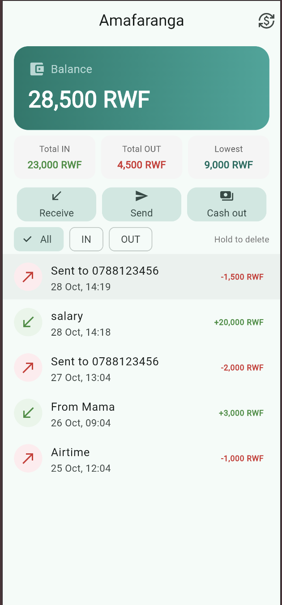
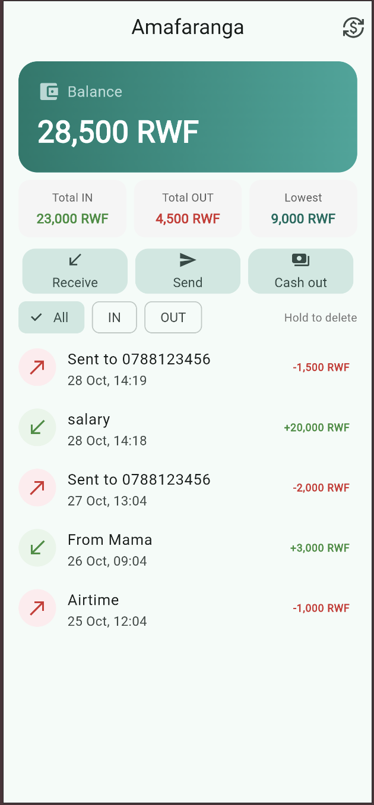
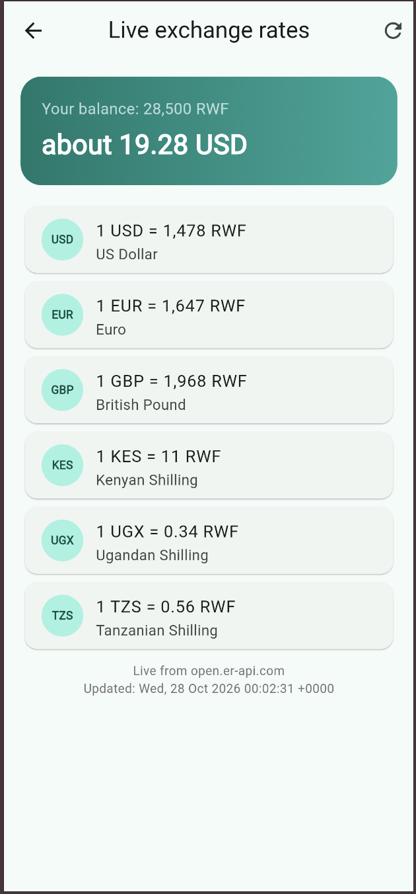
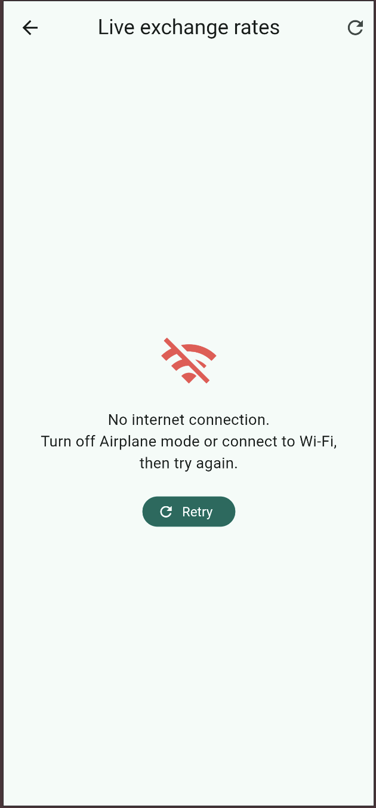

# Amafaranga (MoMo Wallet)

A mobile-money wallet where you receive money, send money to 078/079 numbers and cash out at an agent. My data is now saved on the phone with shared_preferences, so nothing is lost when the app closes, and it shows live exchange rates (USD, EUR, GBP, KES, UGX, TZS to RWF) from the open.er-api.com API.

## Screenshots

